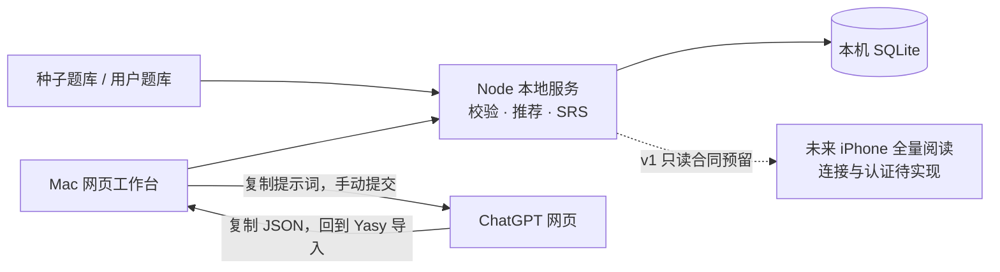

# yasy · 自己的雅思学习工作台

**真实素材 × 地道表达。** 从自己的中文经历和观点出发，准备完整英文答案，再把可复用的素材与好词句留下来。

Mac 本机优先 · 默认 **IELTS Academic / Band 7.0** · SQLite 私人学习库 · ChatGPT 网页半自动桥接

[开始使用](#开始使用) · [学习流程](#一道题的完整流程) · [导入自己的题库](#导入自己的题库) · [数据备份](#数据与备份) · [产品设计](docs/product-design.md)


## 五个学习入口

| 入口 | 可以做什么 |
| --- | --- |
| **今日积累** | 一起安排口语与作文；接着写草稿、完成待处理任务，查看今天的积累。 |
| **背书** | 按到期时间复习口语、作文或单词；答案模式每次只展示一份完整答案，记录已背次数。 |
| **口语区** | 按主题浏览 Part 1 基础问答、Part 2 题卡与 Part 3 延伸讨论；整理独立口语素材库、语料库。 |
| **作文区** | Academic Task 1 / Task 2 分开练习；图表描述与正式论证使用各自提示词和语料库。 |
| **单词本** | 口语与写作统一收藏；保留来源，可分区筛选、随机乱序，也可进入到期复习。 |

目标分数和每日题量可在「偏好与数据」调整。Band 7.0 是默认训练目标，系统不将 AI 输出当作真实考试评分。

## 开始使用

需要 **Node.js 22.13 或更新版本**，推荐 Node.js 24。在项目目录运行：

```sh
npm ci
npm run build
npm start
```

打开 [本机工作台](http://127.0.0.1:4318)。以后也可以双击 **[启动 Yasy.command](启动%20Yasy.command)**：缺少依赖时自动安装，随后构建、启动并打开浏览器。终端窗口需保持运行；服务已启动时会直接打开现有工作台。

开发模式：

```sh
npm run dev
```

前端为 [127.0.0.1:5178](http://127.0.0.1:5178)，本地服务为 `127.0.0.1:4318`。默认仅本机可访问。

## 一道题的完整流程

1. **打开题目，写真实中文素材。** 没有积累时从空白开始；有相关素材时先选一个或多个，系统预填中文，继续修改和补充。草稿自动保存。
2. **检查素材是否充分。** 本地初检提供补充方向；网页 AI 再检查贴题性、细节和论证。未通过时返回建议，保留中文草稿供重写。
3. **复制专用提示词，打开 ChatGPT。** 在自己登录的网页中手动提交；口语、Task 1、Task 2 各有独立处理方式。
4. **把完整 JSON 粘贴回 Yasy。** 先预览，再校验任务绑定、题目、学习域及引用；通过后保存本题唯一当前答案。
5. **读答案，留下积累。** 英文答案、英文语料与用法进入学习界面；独立素材元保存中英对照，相关题目推荐留在同一个学习域。
6. **继续下一题。** 系统展示真正相关的 Top 3 素材建议；用户选材后重新组织新题答案，仍可自由补写中文。

### 素材与语料，两条线同时积累

| 积累 | 保存的内容 | 复用方式 |
| --- | --- | --- |
| **素材元** | 与题目问法解耦的核心事件、事实或论证；中文摘要与细节、事实等值的英文摘要与细节。 | 与题目多对多关联；选用时预填中文，再按新题改写。 |
| **语料** | 答案中实际出现的地道表达、情绪态度、搭配与句式；以英语展示分类、例句和用法。 | 独立检索，与素材多对多关联，展示相关度较高的前 3 项。 |
| **答案** | 当前题目的一份完整英文回答或作文。 | 同题再次整理更新当前答案；背书只读当前版本。 |

三个学习域严格分开：`speaking`、`writing-task1`、`writing-task2`。口语与作文不交叉推送素材或语料；**Task 1 不创建素材元**，重点积累趋势、比较、流程和地图表达。单词本可以跨来源统一复习。

### 在答案里直接阅读积累

- **黄、蓝、绿底色**标记来自不同素材元的真实片段，点击查看对应的中英素材。
- **红色波浪线**标记好词句，点击查看英文语料与用法；与素材底色重叠时优先打开语料。
- 练习答案和背书答案共用同一套标注渲染，保留完整英文正文。
- 在支持收藏的英文区域**右键单词**，或选中短语后右键，收进单词本。移动触屏的长按入口已预留；实际 iPhone 联通仍待完成。

## 导入自己的题库

支持 **PDF / DOC / DOCX**，单文件最大 10 MB，每批最多 500 道题。可在口语区、作文区或「偏好与数据」开始导入。

```text
原文件上传到本机
   → 复制文件提取提示词，打开 ChatGPT 网页
   → 用户手动附上同一原文件，提交提示词
   → 把返回的 JSON 粘贴回 Yasy
   → 预览分层题目，勾选需要收录的题目
   → 确认入库，保存来源并跳过重复题
```

本机保存原文件和导入任务，当前文件正文由 ChatGPT 网页读取。用户需要亲自向网页附文件；在 Yasy 上传文件不会自动向 ChatGPT 发送。

题目按主题、口语 Part 或写作 Task 分类，并保留文件名、页码／题号及原题或改写说明。原文件可通过界面链接在本机下载。Task 1 缺少可用原图时保留“待补图”状态，在补齐图表信息前不能据此生成完整作文。文件名称中的“真题”“当季”不替代来源核验。

## 背书与间隔复习

口语答案、作文答案和单词使用独立复习队列，优先展示已到期内容，并按到期时间排序。答案队列每次展示**一份完整答案**；点击「我已背过，下一份」后保存次数，并安排下一次复习。

| 完成的复习阶段 | 下次间隔 |
| --- | --- |
| 第 1 / 2 / 3 次 | 1 / 3 / 7 天 |
| 第 4 / 5 / 6 次 | 14 / 30 / 60 天 |
| 第 7 次及以后 | 90 天 |

次数和到期时间保存在 SQLite，刷新或重启后仍保留。重新整理答案会让新版本重新进入首轮复习，同时保留累计已背次数。当前采用固定间隔 SRS，不依赖 AI 调度。

## 首批题库：168 道，出处可追溯

| 学习域 | 数量与结构 |
| --- | --- |
| 口语 | **123** 道：Part 1 **59**、Part 2 **19**、Part 3 **45**；Part 2 含 1 道明确标记的收尾追问。 |
| Academic Task 1 | **16** 道：表格、柱状图、折线、饼图、流程、地图与混合数据练习。 |
| Task 2 | **29** 道：同意与否、双边讨论、原因与影响、问题与解决、双问题与利弊权衡。 |

共 **41 个主题、36 个来源入口**，每道题保留来源链接、核验日期和题干性质：

| 标签 | 数量 | 含义 |
| --- | --- | --- |
| `official` | **15** | 官方公开样题或教学例题的短摘录。 |
| `reported` | **14** | 第三方收集的考生回忆短摘录，未经官方认证。 |
| `adapted` | **139** | 按注明来源的主题或题型练习性改写。 |

**全部 16 道 Task 1 的本地图表与布局均为自建练习（synthetic）**，不是官方数据、考试原图或报道重绘图的数据。回忆来源范围为 **2025 年 5 月至 2026 年 5 月**；本版不声称提供完整官方当季真题库，也不宣称覆盖 2026 年 9–12 月考季。

查看 [逐源索引与收录边界](docs/question-sources.md) · [种子数据](data/question-bank.json) · [IELTS 官方样题](https://ielts.org/take-a-test/preparation-resources/sample-test-questions/academic-test) · [British Council 写作练习](https://takeielts.britishcouncil.org/prepare/ielts-free-practice-mock-tests/academic/writing)。

## 本机架构与手机预留



前端使用 React、TypeScript、Vite；本地服务使用 Node 原生 HTTP 与 SQLite。AI provider 和结构化结果合同独立于界面，后续可接正式 API 或经过验证的浏览器自动化。

**当前 AI 桥接是半自动。** 提示词生成、结果校验与入库已实现；网页提交、附文件和复制 JSON 由用户完成。API 与全自动浏览器处理尚未接入。

iPhone 已预留响应式阅读界面及以下 **v1 只读合同**，未来可全量查看题库、答案、草稿、素材、语料与复习状态：

| 接口 | 用途 |
| --- | --- |
| `/api/v1/manifest` | 读取版本、能力和只读接口声明。 |
| `/api/v1/snapshot` | 获取全量学习快照。 |
| `/api/v1/content/{questionId}` | 获取某题的完整学习内容。 |

服务仍仅监听 Mac 的 `127.0.0.1`。**跨设备认证、配对、实际连接与同步尚未上线**；仅有响应式界面与接口不意味着 iPhone 已能访问。中文素材书写和 AI 处理以 Mac 为主要入口。

## 数据与备份

默认数据位置：

```text
.local/
├── yasy.sqlite     # 私人学习数据库
└── uploads/        # 上传的 PDF / DOC / DOCX 原文件
```

可通过 `YASY_DATA_DIR` 调整存储目录。`.local/`、SQLite 文件与环境文件均被 Git 忽略；私人学习数据和上传文件不会随项目代码推送到 GitHub。

- **学习数据**：在「偏好与数据」导出 JSON 备份，包含题库、草稿、答案、素材、语料、关联、单词、任务和复习记录。恢复会替换当前学习数据，界面要求确认；校验失败会回滚，恢复前快照可下载。
- **上传原文件**：JSON 备份不包含原文件内容，需另行备份 **`.local/uploads/`**。换机时仅恢复 JSON，可以保留题目，但原文件下载仍需对应文件目录。
- **运行中的数据库**：优先使用界面导出，不只复制可能正在写入的 SQLite 主文件而遗漏 WAL。

中文素材和上传文件留在本机。向 ChatGPT 网页提交提示词或附文件时，由用户将相应内容发送至第三方。

## 开发与检查

```sh
npm test          # 本机 API 与 SQLite 的端到端业务测试
npm run check     # TypeScript 检查
npm run build     # 构建网页工作台
```

测试覆盖答案导入、任务绑定、唯一当前答案、三库隔离、质量反馈、推荐、批量题库、复习与备份等业务。仓库附带 [GitHub Actions 模板](.github/checks.example.yml)，可在启用 workflow 权限后放入 workflows 目录，自动执行依赖安装、测试和构建。

| 文档 | 内容 |
| --- | --- |
| [产品设计](docs/product-design.md) | 手稿到产品流程、实体关系、分库约束与完成标准。 |
| [AI 桥接设计](docs/ai-bridge.md) | 三套提示词、JSON 合同、导入校验和 provider 扩展。 |
| [手机 API](docs/mobile-api.md) | 全量阅读合同、标注索引与连接预留。 |
| [题库来源](docs/question-sources.md) | 逐源链接、核验范围、版权与改写说明。 |
