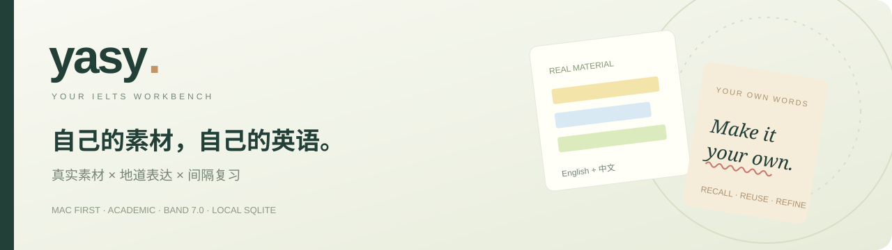
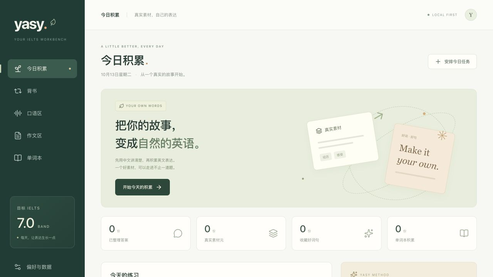
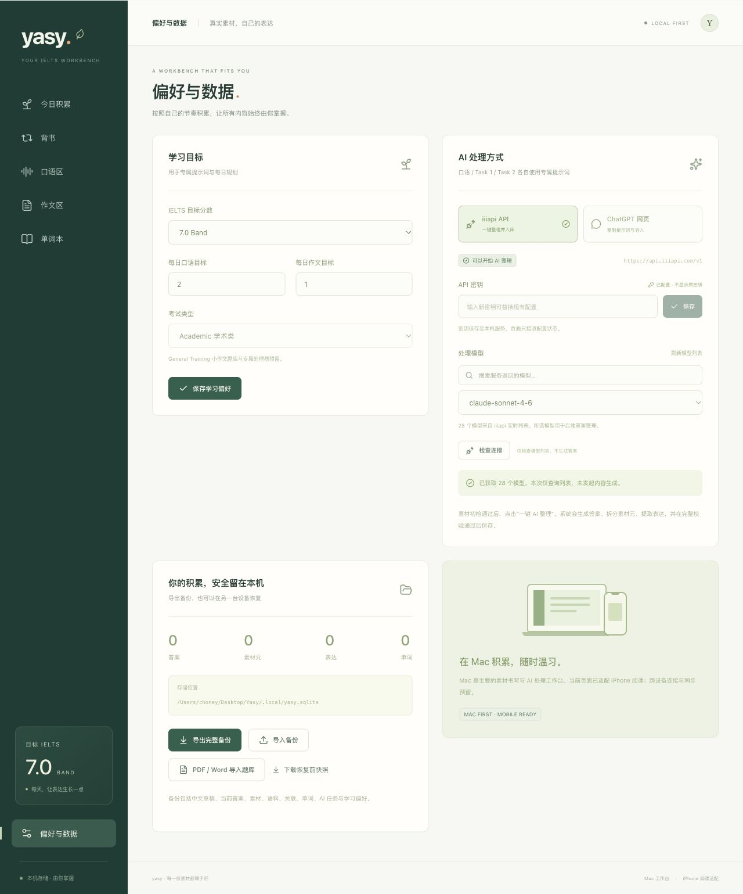
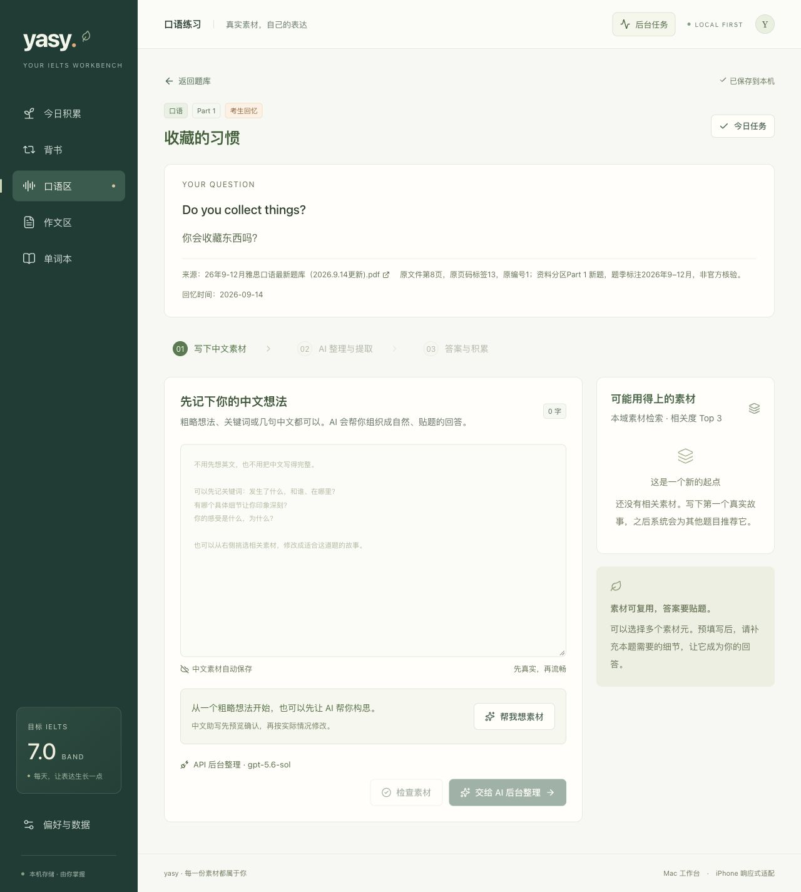
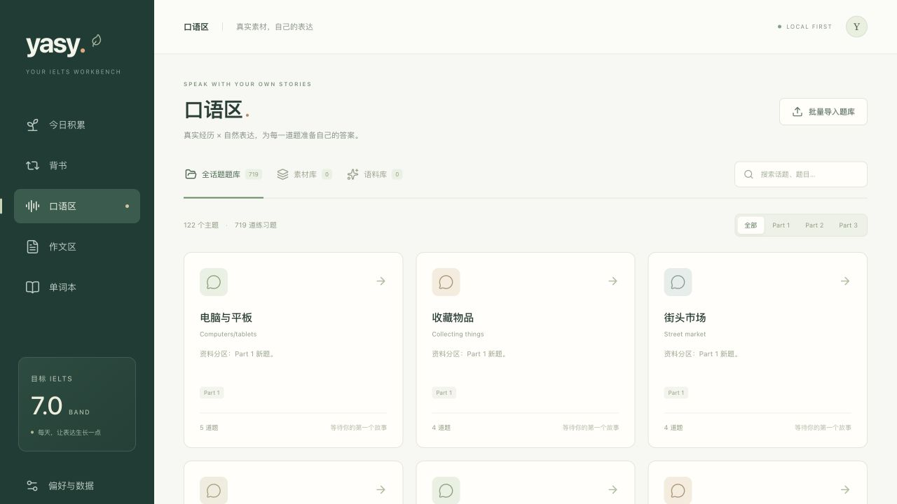
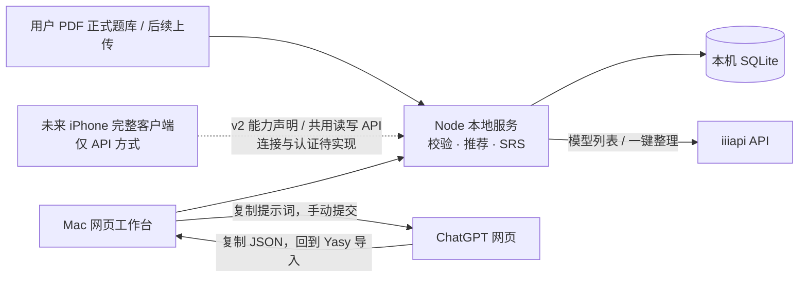

# yasy · 自己的雅思学习工作台

**真实素材 × 地道表达。** 从自己的中文经历和观点出发，准备完整英文答案，再把可复用的素材与好词句留下来。

Mac 本机优先 · **IELTS Academic / Band 7.0** · SQLite 私人学习库 · **API 后台整理 + Mac 网页桥**

[开始使用](#开始使用) · [配置 AI](#配置-ai) · [学习流程](#一道题的完整流程) · [正式题库](#正式题库743-道来自两份用户-pdf) · [数据备份](#数据与备份) · [产品设计](docs/product-design.md)



## 五个学习入口

| 入口 | 可以做什么 |
| --- | --- |
| **今日积累** | 一起安排口语与作文；接着写草稿、完成待处理任务，查看今天的积累。 |
| **背书** | 按到期时间复习口语、作文或单词；答案模式每次只展示一份完整答案，记录已背次数。 |
| **口语区** | 按主题浏览 Part 1 基础问答、Part 2 题卡与 Part 3 延伸讨论；整理独立口语素材库、语料库。 |
| **作文区** | Task 2 已收录用户资料中的 24 道题；Academic Task 1 界面与提示词已保留，目前题库为空，等待后续上传。 |
| **单词本** | 口语与写作统一收藏；保留来源，可分区筛选、随机乱序，也可进入到期复习。 |

目标分数和每日题量可在「偏好与数据」调整。Band 7.0 是默认训练目标，系统不将 AI 输出当作真实考试评分。

## 开始使用

需要 **Node.js 22.13 或更新版本**，推荐 Node.js 24。在项目目录运行：

```sh
npm ci
npm run build
npm start
```

打开 [本机工作台](http://127.0.0.1:4318)。以后也可以双击 **[启动 Yasy.command](启动%20Yasy.command)**：缺少依赖时自动安装，随后构建、启动并打开浏览器。终端窗口需保持运行；服务已启动时会直接打开现有工作台。

开发模式：

```sh
npm run dev
```

前端为 [127.0.0.1:5178](http://127.0.0.1:5178)，本地服务为 `127.0.0.1:4318`。默认仅本机可访问。

## 配置 AI

在「偏好与数据 → AI 处理方式」选择 **iiiapi API**，保存自己的密钥，刷新服务返回的模型列表，再选择并保存处理模型。模型以用户当前选择为准；新环境需要自行配置密钥和模型。

「检查连接」只查询模型列表；中文构思、答案整理、语料复核和文件提取会调用所选模型。可用模型以账号实时列表为准。答案整理任务在本地服务后台运行，可以离开当前题继续写别题，App 的全局任务通知会提示处理进度与结果。



| 方式 | 操作 |
| --- | --- |
| **iiiapi API** | 一次调用完成英文答案、双语素材、精选语料及推荐；本地校验通过后自动保存。 |
| **ChatGPT 网页 · Mac** | 复制专用提示词，在网页手动提交，再把完整 JSON 返回 Yasy 导入；不需要 API 密钥。 |

密钥单独保存在 **`.local/api-secrets.json`**，文件权限为 **600**。保存后界面只显示“已配置”等状态，不回显原密钥；密钥不进入 Git、学习 state、手机快照或 JSON 备份。更换 Mac 后需要重新配置。详情见 [AI 处理与网页桥](docs/ai-bridge.md)。

## 一道题的完整流程

1. **打开题目，写真实中文原料。** 简短想法、经历和观点即可；有推荐素材时先选一个或多个，预填中文后再修改。没有思路时可点「帮我想素材」，先预览 AI 中文构思，再按真实情况采纳或修改；不会自动覆盖草稿。
2. **检查核心内容是否够用。** 初检提示空白或过短输入；AI 检查关键事实、对象与立场。中文尚未写成完整答案不应成为拒绝理由；必须补充真实内容时才返回建议。
3. **按题型组织和展开。** AI 选择相关内容、调整顺序、补充合理解释与衔接，形成完整英文答案。口语、Task 1、Task 2 使用独立提示词；不添加未经提供的亲历、数字或研究结论。
4. **一次成稿、校验后保存。** 详细提示词在同一次生成中落实任务回应、内容展开、连贯、词汇、语法和语料筛选。后端只检查任务绑定、学习域、素材版本、标注、词数和准入合同，再以 SQLite 事务保存唯一当前答案；不追加模型审核调用，不自动重试。网页方式由用户带回 JSON，沿用本地校验。
5. **读答案，留下值得复用的积累。** 英文答案与合格语料进入学习界面；素材元保存中英对照，相关题推荐留在同一学习域。没有合格语料也能保存答案。
6. **继续下一题或进入背书。** 系统展示相关的 Top 3 素材建议；选材后重新组织新题答案，仍可自由补写中文。

API 任务显示待处理、后台处理中、失败、需补充或完成。离开题目、切换页面或刷新不停止本地后台任务；Mac 的服务进程需保持运行。超时、截断或校验失败不会保存半份答案；服务重启或备份恢复中遗留的处理中任务会转为失败，可重新确认后重试。网页桥仍是“复制 → 手动提交 → 粘贴 JSON”，不会显示成 API 自动任务。

「帮我想素材」是用户点击后单独触发的一次调用：空白时生成可修改示例，有中文时展开现有事实和思路，始终返回中文预览，确认后才填入。随后点击「AI 整理」才另发一次正式答案请求；两者互不自动触发，中文助写不会直接存成英文答案或真实素材。



口语练习建议为 Part 1 **35–80** 词、Part 2 **170–260** 词、Part 3 **70–130** 词，均是产品训练目标，官方口语没有对应词数门槛；纯文字也不能评估发音。Academic Task 1 至少 **150** 词、Task 2 至少 **250** 词。规则与三套组织方法见 [产品设计](docs/product-design.md#三套独立处理方法)。

### 素材与语料，两条线同时积累

| 积累 | 保存的内容 | 复用方式 |
| --- | --- | --- |
| **素材元** | 与题目问法解耦的核心事件、事实或论证；中文摘要与细节、事实等值的英文摘要与细节。 | 同一核心保留稳定 ID；新增真实细节可更新版本、查看历史。选用时预填中文，再按新题组织。 |
| **语料** | 答案中实际出现、通过 AI 判断和本地准入检查的搭配、地道表达、精确措辞与可迁移句式；用英语展示用法。 | 独立检索，与素材多对多关联，展示相关度较高的前 3 项。 |
| **答案** | 当前题目的一份完整英文回答或作文。 | 同题再次整理更新当前答案；背书只读当前版本。 |

三个学习域严格分开：`speaking`、`writing-task1`、`writing-task2`。口语与作文不交叉推送素材或语料；**Task 1 不创建素材元**，重点积累趋势、比较、流程和地图表达。单词本可以跨来源统一复习。

素材更新保存版本历史；每份答案保留其当时使用的素材快照，后续补充不会改变旧答案的事实依据。同时更新同一素材时采用版本检查，较旧的结果会提示重新处理。

### 语料有明确的准入门槛

`I think`、`very good`、`for example` 或普通孤立单词不会仅因出现在答案中就收录。`strike a balance`、`build confidence` 等简短搭配可以通过：需要明确用途、收录理由、可迁移例句，并符合本区语域、能在答案中定位。

语料库只接纳 `approved` 条目，允许一次整理收录 **0 条**。旧条目可批量交给 AI 复核；`pending` 与 `rejected` 保留原记录和原因，不删除历史积累，也不作为已通过的推荐。AI 的收录判断是学习辅助，不能代替官方评分。详见 [语料准入](docs/corpus-admission.md)。

### 在答案里直接阅读积累

- **黄、蓝、绿底色**标记来自不同素材元的真实片段，点击查看对应的中英素材。
- **红色波浪线**标记好词句，点击查看英文语料与用法；与素材底色重叠时优先打开语料。
- 练习答案和背书答案共用同一套标注渲染，保留完整英文正文。
- 阅读正文、题目与说明增强了字号和对比度，方便长时间查看；颜色片段仍可点击追溯。
- 在支持收藏的英文区域**右键单词**，或选中短语后右键，收进单词本。移动触屏的长按入口已预留；实际 iPhone 联通仍待完成。

## 导入自己的题库

支持 **PDF / DOC / DOCX**，单文件最大 10 MB，每批最多 **1000 道题**。可在口语区、作文区或「偏好与数据」开始导入；两种提取方式都先预览，再由用户勾选确认。

```text
原文件上传到本机
   → API 提取并组织题目 / Mac 网页提取
   → 预览分层题目，勾选需要收录的题目
   → 确认入库，保存来源并跳过重复题
```

**API 方式**由本地服务读取支持的文件内容，再调用所选模型生成题目预览；预览完成不会自动入库。**Mac 网页方式**仍需复制专用提示词、打开 ChatGPT、手动附上同一原文件，再把 JSON 粘贴回 Yasy；本机上传不会自动向 ChatGPT 网页发送文件。手机未来仅提供 API 方式。

题目按主题、口语 Part 或写作 Task 分类，保留文件名、可靠页码／题号及原题或改写说明；Word 无法可靠分页时不猜页码。原件可在本机下载。**API 目前读取文字层，未实现 OCR 或题图识别，Task 1 一律标记待补图/数据**；网页方式也只保留实际读到的图表信息。补齐前不能生成完整作文，资料文件名里的“真题”“当季”不替代核验。

## 背书与间隔复习

口语答案、作文答案和单词使用独立复习队列，优先展示已到期内容，并按到期时间排序。答案队列每次展示**一份完整答案**；点击「我已背过，下一份」后保存次数，并安排下一次复习。

| 完成的复习阶段 | 下次间隔 |
| --- | --- |
| 第 1 / 2 / 3 次 | 1 / 3 / 7 天 |
| 第 4 / 5 / 6 次 | 14 / 30 / 60 天 |
| 第 7 次及以后 | 90 天 |

次数和到期时间保存在 SQLite，刷新或重启后仍保留。重新整理答案会让新版本重新进入首轮复习，同时保留累计已背次数。当前采用固定间隔 SRS，不依赖 AI 调度。

## 正式题库：743 道，来自两份用户 PDF



| 学习域 | 数量与结构 | 资料范围 |
| --- | --- | --- |
| 口语 | **719** 条：Part 1 **245**、Part 2 **77**、Part 3 **397**；共 **122** 个主题。 | 用户提供的 2026 年 9–12 月口语资料，文件标注 2026-09-14 更新。 |
| Task 2 | **24** 道、**10** 个主题。 | 用户提供的 2026 年 1–8 月纸笔大作文汇总，逐场保留日期和全部问法。 |
| Academic Task 1 | **0** 道。 | 保留独立练习能力与语料库，等待后续上传带完整原图的数据。 |

合计 **743 条题目、132 个主题、2 个正式来源**。全部保留英文题干、中文辅助译文、来源物理页码与资料标记；**条目数包含原资料中重复出现的题目**，不等于独特题干数。原文歧义、拼写异常及“待补充”标记有审计说明，不凭猜测补题或悄悄改写。

两份文件都标记为 `user-upload` 来源，题目为 `reported` 资料转录。“最新”“新题”“旧题”“必考题”与题季是文件自身说法，**不表示 Yasy 已获得官方题库或核验了考试真实性**。

正式 JSON 随代码提交至私人仓库；**原 PDF 只保存在本机 `.local/source-pdfs/`**，不进入 Git。查看 [来源与收录边界](docs/question-sources.md) · [合并题库](data/question-bank.json) · [口语 JSON](data/imported-speaking.json) / [逐页审计](docs/pdf-speaking-audit.md) · [Task 2 JSON](data/imported-writing.json) / [逐页审计](docs/pdf-writing-audit.md)。

### 更替题库与旧题归档

本次正式题库替换了先前的练习种子库。更替前应先导出学习备份；新题库启用后，已有数据库中的旧题会归档，保留旧草稿、答案、素材、语料和复习记录，避免删除已有积累。归档题可查看历史内容，不能继续生成新答案；今日任务与相关题候选使用当前活动题库。

已有数据库可能仍包含历史来源和归档题，因此历史记录数量可以大于上表的正式题库数量。恢复旧备份会恢复其题库与学习状态；恢复前先备份当前内容，不通过删除 SQLite 文件来切换题库。

## 本机架构与手机预留



前端使用 React、TypeScript、Vite；本地服务使用 Node 原生 HTTP 与 SQLite。iiiapi 调用由后端处理，Mac 保留手动网页桥。全自动操控 ChatGPT 浏览器未实现。

iPhone 的未来定位为 **与 Mac 同功能的完整客户端**：题库、中文书写、API 整理、素材版本、语料复核、批量导入、单词与背书均使用同一后端；手机 UI 仅保留 API provider。当前保留如下合同：

| 接口 | 用途 |
| --- | --- |
| `/api/v2/manifest` | 声明 `full-client`、手机 API-only 策略，以及共用 `/api` 读写路径。 |
| `/api/v1/manifest` | 保留旧 `full-reader` 只读合同，兼容已有阅读客户端。 |
| `/api/v1/snapshot` | 获取全量学习快照。 |
| `/api/v1/content/{questionId}` | 获取某题的完整学习内容。 |

服务仍仅监听 Mac 的 `127.0.0.1`。**跨设备认证、配对、实际连接与同步尚未上线**；完整客户端合同与响应式界面不意味着 iPhone 已连接。Mac 仍是当前主要工作台，后续连接层将接入同一功能。详情见 [手机 API](docs/mobile-api.md)。

## 数据与备份

默认数据位置：

```text
.local/
├── yasy.sqlite       # 私人学习数据库
├── api-secrets.json  # API 密钥与模型配置，权限 600
├── source-pdfs/      # 本次两份正式来源 PDF
└── uploads/          # 后续批量导入的 PDF / DOC / DOCX 原文件
```

可通过 `YASY_DATA_DIR` 调整存储目录。`.local/`、SQLite 文件与环境文件均被 Git 忽略；私人学习数据和上传文件不会随项目代码推送到 GitHub。

- **学习数据**：在「偏好与数据」导出 JSON 备份，包含题库、草稿、答案、素材、语料、关联、单词、任务和复习记录。恢复会替换当前学习数据，界面要求确认；校验失败会回滚，恢复前快照可下载。
- **原文件**：JSON 备份不含文件内容，需另行备份 **`.local/source-pdfs/` 与 `.local/uploads/`**。仅恢复 JSON 能保留题目和译文，原件下载还需要对应目录。
- **API 配置**：密钥不在 JSON 备份中；换机后重新配置，不把密钥文件加入题库包或仓库。
- **运行中的数据库**：优先使用界面导出，不只复制可能正在写入的 SQLite 主文件而遗漏 WAL。

SQLite 与原文件保存在本机。使用 iiiapi 整理时，会把当前题目、中文草稿、选中素材及同区候选题发送给该服务；使用 ChatGPT 网页时，由用户提交提示词或附文件。本机保存不表示 AI 处理始终离线。

## 开发与检查

```sh
npm test          # 本机 API 与 SQLite 的端到端业务测试
npm run check     # TypeScript 检查
npm run build     # 构建网页工作台
```

测试覆盖答案导入、任务绑定、后台处理、唯一当前答案、素材版本、语料准入、三库隔离、批量题库、复习与备份等业务。仓库附带 [GitHub Actions 模板](.github/checks.example.yml)，可在启用 workflow 权限后放入 workflows 目录，自动执行依赖安装、测试和构建。

| 文档 | 内容 |
| --- | --- |
| [产品设计](docs/product-design.md) | 手稿到产品流程、实体关系、分库约束与完成标准。 |
| [AI 处理与网页桥](docs/ai-bridge.md) | iiiapi 配置、三套提示词、结果合同、校验与失败恢复。 |
| [手机 API](docs/mobile-api.md) | v2 完整客户端与共用读写 API、v1 兼容合同、连接预留。 |
| [语料准入](docs/corpus-admission.md) | 收录门槛、AI 判断与本地检查、历史语料状态。 |
| [题库来源](docs/question-sources.md) | 两份 PDF 的覆盖范围、原文保留、逐页审计与更替归档。 |
