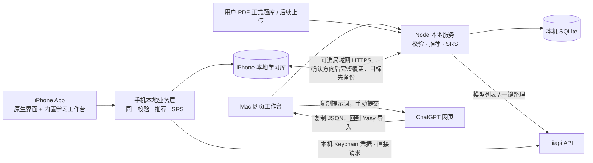
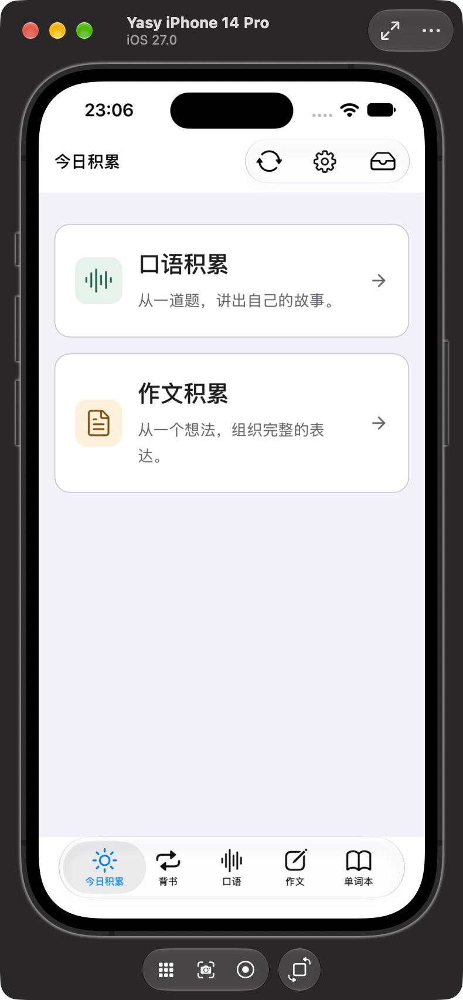

# yasy · 自己的雅思学习工作台

**真实素材 × 地道表达。** 从自己的中文经历和观点出发，准备完整英文答案，再把可复用的素材与好词句留下来。

Mac 与 iPhone 各自独立学习 · **IELTS Academic / Band 7.0** · 纯净刷题 · **单次 API 整理**

[开始使用](#开始使用) · [配置 AI](#配置-ai) · [学习流程](#一道题的完整流程) · [正式题库](#正式题库743-道来自两份用户-pdf) · [数据备份](#数据与备份) · [产品设计](docs/product-design.md)


## 五个学习入口

| 入口 | 可以做什么 |
| --- | --- |
| **今日积累** | 只选口语或作文，一次推送一道未积累题；可换题，完成后随机进入下一道未积累题。 |
| **背书** | 按到期时间复习口语、作文或单词；答案模式每次只展示一份完整答案，记录已背次数。 |
| **口语区** | 按主题浏览 Part 1 基础问答、Part 2 题卡与 Part 3 延伸讨论；整理独立口语素材库、语料库。 |
| **作文区** | Task 2 已收录用户资料中的 24 道题；Academic Task 1 界面与提示词已保留，目前题库为空，等待后续上传。 |
| **单词本** | 口语与写作统一收藏；保留来源，可分区筛选、随机乱序，也可进入到期复习。 |

目标分数可在「偏好与数据」调整；今日积累直接逐题练习，不安排每日题量。Band 7.0 是默认训练目标，系统不将 AI 输出当作真实考试评分。

## 开始使用

**iPhone**：安装 App 后直接进入学习界面，不需要开启 Mac 或先配对。题库随 App 提供，草稿、答案与积累保存在此 iPhone；在手机「偏好与数据」配置自己的 API 密钥和模型，即可通过互联网整理答案。安装步骤见 [iPhone 开发与真机测试](docs/ios-setup.md)。阅读、中文书写、收藏和复习可离线进行；AI 操作需要联网。

**Mac 网页端**需要 **Node.js 22.13 或更新版本**，推荐 Node.js 24。在项目目录运行：

```sh
npm ci
npm run build
npm start
```

打开 [本机工作台](http://127.0.0.1:4318)。以后也可以双击 **[启动 Yasy.command](启动%20Yasy.command)**：缺少依赖时自动安装，随后构建、启动并打开浏览器。终端窗口需保持运行；服务已启动时会直接打开现有工作台。

开发模式：

```sh
npm run dev
```

前端为 [127.0.0.1:5178](http://127.0.0.1:5178)，本地服务为 `127.0.0.1:4318`。默认仅本机可访问。

## 配置 AI

在「偏好与数据 → AI 处理方式」配置 **iiiapi API**，保存自己的密钥，刷新服务返回的模型列表，再选择并保存处理模型。Mac 和 iPhone 分别配置，不会从另一端自动取得密钥；手机仅提供 API 方式，Mac 还可以选择网页桥。模型以本端当前选择为准。

「检查连接」只查询模型列表；中文构思、答案整理、语料复核和文件提取会调用所选模型。可用模型以账号实时列表为准。答案任务在当前设备处理，可以离开当前题继续写别题，全局任务通知会提示进度与结果；iPhone 直接请求模型服务，不经过 Mac。


| 方式 | 操作 |
| --- | --- |
| **iiiapi API** | 一次调用完成英文答案、双语素材、精选语料及推荐；本地校验通过后自动保存。 |
| **ChatGPT 网页 · Mac** | 复制专用提示词，在网页手动提交，再把完整 JSON 返回 Yasy 导入；不需要 API 密钥。 |

Mac 密钥单独保存在 **`.local/api-secrets.json`**，文件权限为 **600**；iPhone 的密钥与所选模型保存在**本机 Keychain**，原生网络层持密钥发起请求。保存后界面只显示配置状态，不回显原密钥；密钥不进入 Git、学习 state、JSON 备份或两端进度同步。换设备后需要重新配置。详情见 [AI 处理与网页桥](docs/ai-bridge.md)。

## 一道题的完整流程

1. **进入今日积累，选择口语或作文。** 系统按题库顺序打开第一道未积累题，可随时换道题；也可从独立口语区/作文区直接选题。随后写真实中文原料。 简短想法、经历和观点即可；有推荐素材时先选一个或多个，预填中文后再修改。没有思路时可点「帮我想素材」，先预览 AI 中文构思，再按真实情况采纳或修改；不会自动覆盖草稿。
2. **检查核心内容是否够用。** 初检提示空白或过短输入；AI 检查关键事实、对象与立场。中文尚未写成完整答案不应成为拒绝理由；必须补充真实内容时才返回建议。
3. **按题型组织和展开。** AI 选择相关内容、调整顺序、补充合理解释与衔接，形成完整英文答案。口语、Task 1、Task 2 使用独立提示词；不添加未经提供的亲历、数字或研究结论。
4. **一次成稿、校验后保存。** 详细提示词在同一次生成中落实任务回应、内容展开、连贯、词汇、语法和语料筛选。后端只检查任务绑定、学习域、素材版本、标注、词数和准入合同，再以 SQLite 事务保存唯一当前答案；不追加模型审核调用，不自动重试。网页方式由用户带回 JSON，沿用本地校验。
5. **读答案，留下值得复用的积累。** 英文答案与合格语料进入学习界面；素材元保存中英对照，相关题推荐留在同一学习域。没有合格语料也能保存答案。
6. **随机下一道未积累题，或进入背书。** 今日刷题完成后点击继续，会随机推荐未完成且未在后台处理的题；换题则按题库顺序跳过已完成题。独立题库仍提供指定选题和素材推荐。

API 任务显示待处理、后台处理中、失败、需补充或完成。切换题目或 App 内页面不停止任务。Mac 由服务进程处理，服务需保持运行；iPhone 由本机处理，iOS 可能在锁屏、切到后台或终止 App 后暂停执行，不能保证离开 App 仍持续生成。手机重新打开后，遗留处理中任务会转为失败，供用户确认后重试，不自动重发。超时、截断或校验失败不会保存半份答案。网页桥仍是“复制 → 手动提交 → 粘贴 JSON”，仅在 Mac 提供。

「帮我想素材」是用户点击后单独触发的一次调用：空白时生成可修改示例，有中文时展开现有事实和思路，始终返回中文预览，确认后才填入。随后点击「AI 整理」才另发一次正式答案请求；两者互不自动触发，中文助写不会直接存成英文答案或真实素材。


口语练习建议为 Part 1 **35–80** 词、Part 2 **170–260** 词、Part 3 **70–130** 词，均是产品训练目标，官方口语没有对应词数门槛；纯文字也不能评估发音。Academic Task 1 至少 **150** 词、Task 2 至少 **250** 词。规则与三套组织方法见 [产品设计](docs/product-design.md#三套独立处理方法)。

### 素材与语料，两条线同时积累

| 积累 | 保存的内容 | 复用方式 |
| --- | --- | --- |
| **素材元** | 与题目问法解耦的核心事件、事实或论证；中文摘要与细节、事实等值的英文摘要与细节。 | 同一核心保留稳定 ID；新增真实细节可更新版本、查看历史。选用时预填中文，再按新题组织。 |
| **语料** | 答案中实际出现、通过 AI 判断和本地准入检查的搭配、地道表达、精确措辞与可迁移句式；用英语展示用法。 | 独立检索，与素材多对多关联，展示相关度较高的前 3 项。 |
| **答案** | 当前题目的一份完整英文回答或作文。 | 同题再次整理更新当前答案；背书只读当前版本。 |

三个学习域严格分开：`speaking`、`writing-task1`、`writing-task2`。口语与作文不交叉推送素材或语料；**Task 1 不创建素材元**，重点积累趋势、比较、流程和地图表达。单词本可以跨来源统一复习。

素材更新保存版本历史；每份答案保留其当时使用的素材快照，后续补充不会改变旧答案的事实依据。同时更新同一素材时采用版本检查，较旧的结果会提示重新处理。

### 语料有明确的准入门槛

`I think`、`very good`、`for example` 或普通孤立单词不会仅因出现在答案中就收录。`strike a balance`、`build confidence` 等简短搭配可以通过：需要明确用途、收录理由、可迁移例句，并符合本区语域、能在答案中定位。

语料库只接纳 `approved` 条目，允许一次整理收录 **0 条**。旧条目可批量交给 AI 复核；`pending` 与 `rejected` 保留原记录和原因，不删除历史积累，也不作为已通过的推荐。AI 的收录判断是学习辅助，不能代替官方评分。详见 [语料准入](docs/corpus-admission.md)。

### 在答案里直接阅读积累

- **黄、蓝、绿底色**标记来自不同素材元的真实片段，点击查看对应的中英素材。
- **红色波浪线**标记好词句，点击查看英文语料与用法；与素材底色重叠时优先打开语料。
- 练习答案和背书答案共用同一套标注渲染，保留完整英文正文。
- 阅读正文、题目与说明增强了字号和对比度，方便长时间查看；颜色片段仍可点击追溯。
- 在支持收藏的英文区域**右键单词**，或选中短语后右键，收进单词本。手机长按弹出收藏菜单，单击仍打开素材或语料详情。

## 导入自己的题库

支持 **PDF / DOC / DOCX**，单文件最大 10 MB，每批最多 **1000 道题**。可在口语区、作文区或「偏好与数据」开始导入；两种提取方式都先预览，再由用户勾选确认。

```text
原文件保存到当前设备
   → API 提取并组织题目 / Mac 网页提取
   → 预览分层题目，勾选需要收录的题目
   → 确认入库，保存来源并跳过重复题
```

**API 方式**由当前设备读取支持的文件内容，再调用本端所选模型生成题目预览；预览完成不会自动入库。iPhone 支持可读取文字的 PDF 和 DOCX；旧版二进制 DOC 需先在 Word/Pages 转为 DOCX 或可复制文字的 PDF。**Mac 网页方式**仍需复制专用提示词、打开 ChatGPT、手动附上同一原文件，再把 JSON 粘贴回 Yasy；保存文件不会自动向 ChatGPT 网页发送文件。手机仅提供 API 方式。

题目按主题、口语 Part 或写作 Task 分类，保留文件名、可靠页码／题号及原题或改写说明；Word 无法可靠分页时不猜页码。原件可在本机下载。**API 目前读取文字层，未实现 OCR 或题图识别，Task 1 一律标记待补图/数据**；网页方式也只保留实际读到的图表信息。补齐前不能生成完整作文，资料文件名里的“真题”“当季”不替代核验。

## 背书与间隔复习

口语答案、作文答案和单词使用独立复习队列，优先展示已到期内容，并按到期时间排序。答案队列每次展示**一份完整答案**；点击「我已背过，下一份」后保存次数，并安排下一次复习。

| 完成的复习阶段 | 下次间隔 |
| --- | --- |
| 第 1 / 2 / 3 次 | 1 / 3 / 7 天 |
| 第 4 / 5 / 6 次 | 14 / 30 / 60 天 |
| 第 7 次及以后 | 90 天 |

次数和到期时间保存在当前设备的学习库，重新打开后仍保留。重新整理答案会让新版本重新进入首轮复习，同时保留累计已背次数。当前采用固定间隔 SRS，不依赖 AI 调度。

## 正式题库：743 道，来自两份用户 PDF


| 学习域 | 数量与结构 | 资料范围 |
| --- | --- | --- |
| 口语 | **719** 条：Part 1 **245**、Part 2 **77**、Part 3 **397**；共 **122** 个主题。 | 用户提供的 2026 年 9–12 月口语资料，文件标注 2026-09-14 更新。 |
| Task 2 | **24** 道、**10** 个主题。 | 用户提供的 2026 年 1–8 月纸笔大作文汇总，逐场保留日期和全部问法。 |
| Academic Task 1 | **0** 道。 | 保留独立练习能力与语料库，等待后续上传带完整原图的数据。 |

合计 **743 条题目、132 个主题、2 个正式来源**。全部保留英文题干、中文辅助译文、来源物理页码与资料标记；**条目数包含原资料中重复出现的题目**，不等于独特题干数。原文歧义、拼写异常及“待补充”标记有审计说明，不凭猜测补题或悄悄改写。

两份文件都标记为 `user-upload` 来源，题目为 `reported` 资料转录。“最新”“新题”“旧题”“必考题”与题季是文件自身说法，**不表示 Yasy 已获得官方题库或核验了考试真实性**。

正式 JSON 随代码提交至私人仓库；**原 PDF 在 Mac 的 `.local/source-pdfs/`，不进入 Git**。`ios:prepare` 会把该目录下可用的来源 PDF 附入自用 App，便于手机本地查看；题库和译文不依赖原 PDF 可下载。原件不随 JSON 备份或进度同步传送。查看 [来源与收录边界](docs/question-sources.md) · [合并题库](data/question-bank.json) · [口语 JSON](data/imported-speaking.json) / [逐页审计](docs/pdf-speaking-audit.md) · [Task 2 JSON](data/imported-writing.json) / [逐页审计](docs/pdf-writing-audit.md)。

### 更替题库与旧题归档

本次正式题库替换了先前的练习种子库。更替前应先导出学习备份；新题库启用后，已有数据库中的旧题会归档，保留旧草稿、答案、素材、语料和复习记录，避免删除已有积累。归档题可查看历史内容，不能继续生成新答案；刷题与相关题候选使用当前活动题库。

已有学习库可能仍包含历史来源和归档题，因此历史记录数量可以大于上表的正式题库数量。恢复旧备份会恢复其题库与学习状态；恢复前保留当前内容的快照，不通过删除数据库或卸载 App 来切换题库。

## 两端独立运行，可选手动同步



前端使用 React、TypeScript、Vite。Mac 使用 Node 原生 HTTP 与 SQLite；iPhone 把前端和题库内置于 App，通过手机本地 SQLite 业务运行层复用相同规则，以完整 JSON 学习快照原子保存到 Application Support。iPhone 的 API 网络、Keychain 与文件读写由原生层处理，不依赖 Mac 服务。Mac 保留手动网页桥，全自动操控 ChatGPT 浏览器未实现。

iPhone 工程位于 **[ios/Yasy.xcodeproj](ios/Yasy.xcodeproj)**。系统导航栏、五项标签栏、工具栏和同步按钮采用原生组件，在 iOS 26/27 跟随系统 Liquid Glass 外观；学习内容通过 WKWebView 使用手机自己的题库、草稿、答案、素材、语料、单词与背书记录。打开 App 直接学习，未配对或 Mac 关机不会阻止本地使用。

需要同步时才执行以下步骤：

1. Mac 运行服务，在「偏好与数据 → 连接 iPhone」启用连接，手机与 Mac 接入同一局域网。
2. 在 iPhone 的「可选进度同步」扫描二维码并确认配对；**配对本身不改任何进度**。
3. 对照两端进度，选择**用此 iPhone 进度覆盖 Mac**或**用 Mac 进度覆盖此 iPhone**，再次确认后执行。接收端先保留恢复前快照，再替换全部题库与学习记录；不会自动合并。

Mac 默认仅监听 `127.0.0.1:4318`；启用同步连接后另开 **HTTPS 4319**。配对码5分钟有效、一次性使用、5次错误锁定；每台手机有独立可撤销凭据，App 核对证书指纹、主机名与有效期。**只有同步时**要求 Mac 服务在线并接入本地/私有 IPv4 网络。两端 API 密钥与原始 PDF/DOC/DOCX 文件分别保存，不随学习备份同步；尚未实现自动合并、公网中继或 iCloud 同步。解除配对不删除任何一端的学习记录。

采用草木绿「书页 × 新芽」分层图标，使用 Icon Composer 的 Design Generation 27。内容支持深浅色、大字号、增强对比及降低动态效果/透明度，详见 [iOS 设计规范](docs/ios-design.md) 和 [内容样式与无障碍](docs/ios-content-style.md)。

源码编译通过与真机运行是不同验证：真机签名、账号登录和系统信任需要用户本人完成。具体接口与连接边界见 [手机 API](docs/mobile-api.md)。

## 数据与备份

Mac 默认数据位置：

```text
.local/
├── yasy.sqlite       # 私人学习数据库
├── api-secrets.json  # API 密钥与模型配置，权限 600
├── source-pdfs/      # 本次两份正式来源 PDF
└── uploads/          # 后续批量导入的 PDF / DOC / DOCX 原文件
```

可通过 `YASY_DATA_DIR` 调整 Mac 存储目录。`.local/`、SQLite 文件与环境文件均被 Git 忽略；私人学习数据和上传文件不会随项目代码推送到 GitHub。iPhone 在自身沙盒 `Application Support/Yasy/` 保存学习快照与上传原件，API 配置单独放在 Keychain；手机不读取 Mac 的 `.local/`。

- **学习数据**：两端使用相同 `yasy-backup` v1 JSON，包含题库、草稿、答案、素材及版本历史、语料、关联、单词、任务和复习记录。恢复或手动同步会完整替换接收端数据，均需明确确认；接收端保留恢复前快照，可在「偏好与数据」下载。
- **原文件**：JSON 备份不含文件内容，也不在两端同步时传送。Mac 需另行备份 **`.local/source-pdfs/` 与 `.local/uploads/`**；iPhone 上传原件留在手机沙盒。仅恢复 JSON 能保留题目和译文，下载原件仍需要本端已保存或打包的对应文件。
- **API 配置**：Mac 文件与 iPhone Keychain 各自保存配置，密钥不在 JSON 备份或覆盖同步中；换机后重新配置，不把密钥文件加入题库包或仓库。
- **运行中的数据库**：优先使用界面导出，不只复制可能正在写入的 SQLite 主文件而遗漏 WAL。

学习库与原文件保存在各自设备。使用 iiiapi 整理时，当前设备会把题目、中文草稿、选中素材及同区候选题发送给该服务；使用 Mac 的 ChatGPT 网页方式时，由用户提交提示词或附文件。本地保存不表示 AI 处理离线，也不表示两端会自动保持一致。

## 开发与检查

```sh
npm test          # 本机 API 与 SQLite 的端到端业务测试
npm run check     # TypeScript 检查
npm run build     # 构建网页工作台
npm run ios:check # 检查本机 Xcode、SDK、签名和连接设备
npm run ios:test  # 原生配对与证书检查（临时数据）
npm run ios:prepare # 构建并准备内置网页、题库与可用的来源 PDF
npm run ios:build # 准备资源后执行不签名的模拟器目标构建
```

测试覆盖答案导入、任务绑定、后台处理、唯一当前答案、素材版本、语料准入、三库隔离、批量题库、复习与备份等业务。仓库附带 [GitHub Actions 模板](.github/checks.example.yml)，可在启用 workflow 权限后放入 workflows 目录，自动执行依赖安装、测试和构建。

| 文档 | 内容 |
| --- | --- |
| [产品设计](docs/product-design.md) | 手稿到产品流程、实体关系、分库约束与完成标准。 |
| [AI 处理与网页桥](docs/ai-bridge.md) | iiiapi 配置、三套提示词、结果合同、校验与失败恢复。 |
| [手机 API](docs/mobile-api.md) | 手机本地业务、独立 API 配置、可选 HTTPS 覆盖同步与 v1/v2 兼容。 |
| [iOS 开发与真机测试](docs/ios-setup.md) | Xcode 工程、开发环境、个人签名和 iPhone 测试步骤。 |
| [iOS 设计规范](docs/ios-design.md) | Apple Liquid Glass、原生导航、辅助功能与验收边界。 |
| [语料准入](docs/corpus-admission.md) | 收录门槛、AI 判断与本地检查、历史语料状态。 |
| [题库来源](docs/question-sources.md) | 两份 PDF 的覆盖范围、原文保留、逐页审计与更替归档。 |

### iPhone 独立版预览



原生系统导航与标签栏，森林绿分层图标；图中为 iOS 27 模拟器实测。
